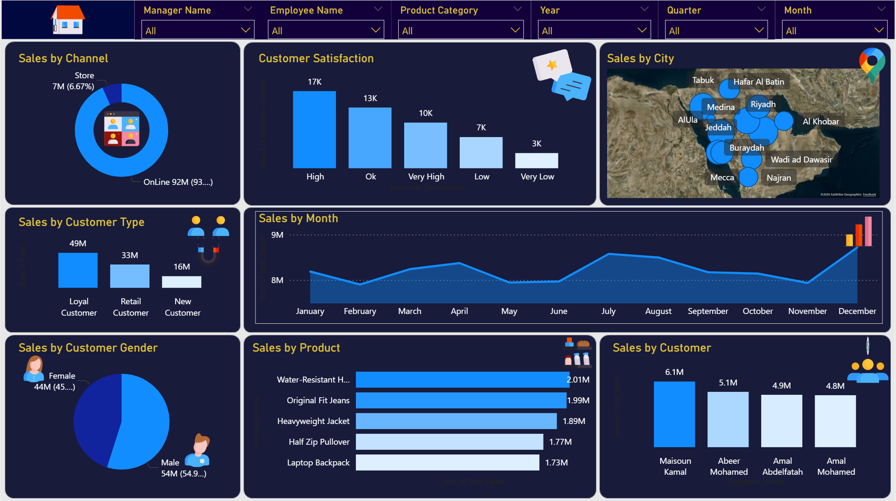
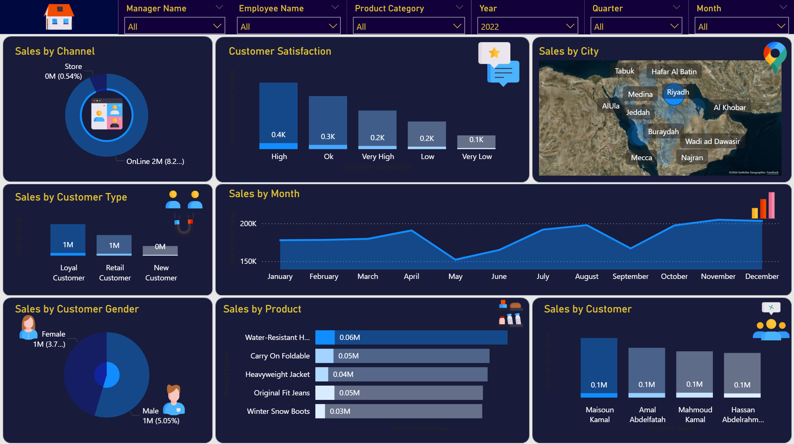

# 📊 Sales & Customer Analytics Dashboard | Power BI

An interactive Power BI dashboard analyzing sales performance, sales channels, customer segments, regional distribution across Saudi cities, and customer satisfaction.

🔗 **[View the live interactive dashboard](https://app.powerbi.com/view?r=eyJrIjoiOTY4NDBiYjUtMDBlZC00YjhjLThlZWEtZmJlYjBjNDA2MDgwIiwidCI6IjJiYjZlNWJjLWMxMDktNDdmYi05NDMzLWMxYzZmNGZhMzNmZiIsImMiOjl9)**

> ⚠️ The dataset is synthetic and was provided as part of the [Investment Academy] Power BI course. This project was built for learning and portfolio purposes.

---

## 🔍 Key Insights

- **Online dominates sales:** 93.3% of revenue (92M) comes from online, while in-store contributes only 6.7% (7M)
- **Loyal customers drive half of revenue:** 49M from loyal customers, compared with 33M from retail and 16M from new customers
- **Customer satisfaction is mostly positive:** 54% of ratings are High or Very High, while 20% are Low or Very Low
- **Male customers lead sales:** 54.9% of revenue (54M) vs 45.1% from female customers (44M)
- **December is the peak sales month**, followed by July
- **Top customer:** Maisoun Kamal generated 6.1M in sales
- **Top 5 products** each generated between 1.73M and 2.01M, led by water-resistant jackets

---

## 📊 Dashboard Features

- **Sales by Channel:** online vs in-store comparison
- **Sales by City:** interactive map across Saudi cities (Riyadh, Jeddah, Al Khobar, Madinah and more)
- **Customer Satisfaction:** ratings from Very High to Very Low
- **Sales by Month:** monthly trend to identify peak periods
- **Sales by Customer Type and Gender:** customer segmentation
- **Top Products and Top Customers:** best-performing products and highest-value customers
- **Slicers:** Manager, Employee, Product Category, Year, Quarter, Month
- **Reset button:** a home icon linked to a bookmark that clears all filters and returns the dashboard to its default view
- **Animated icons:** animated icons next to each visual for a more engaging user experience

### Interactive Filtering

Every visual updates when filters are applied. Example filtered by year (2022):

---

## 🛠️ Tools

- **Power BI Desktop:** report building and dashboard design (dark theme)
- **Power Query:** data cleaning, transformations and custom columns
- **DAX:** calculations and KPI measures
- **Microsoft Excel:** source dataset
- **Bookmarks & Buttons:** reset navigation and interactivity

---

## 📁 Repository Contents

- `Mazen Project.pbix`: Full interactive Power BI report file.
- `Interactive Dashboards Start!.xlsx`: Raw source dataset.
- `Dashboard_full.png`: Main dashboard view.
- `Dashboard_filtered.png`: Filtered view demonstrating interactivity.

---

**Author:** [Mazen Alqarni](https://www.linkedin.com/in/mazen-alqarni-)
